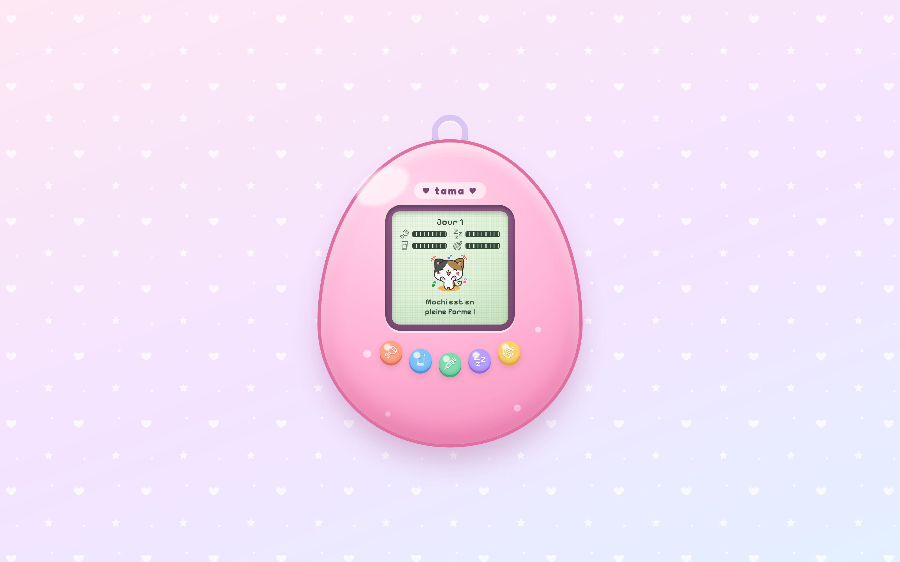
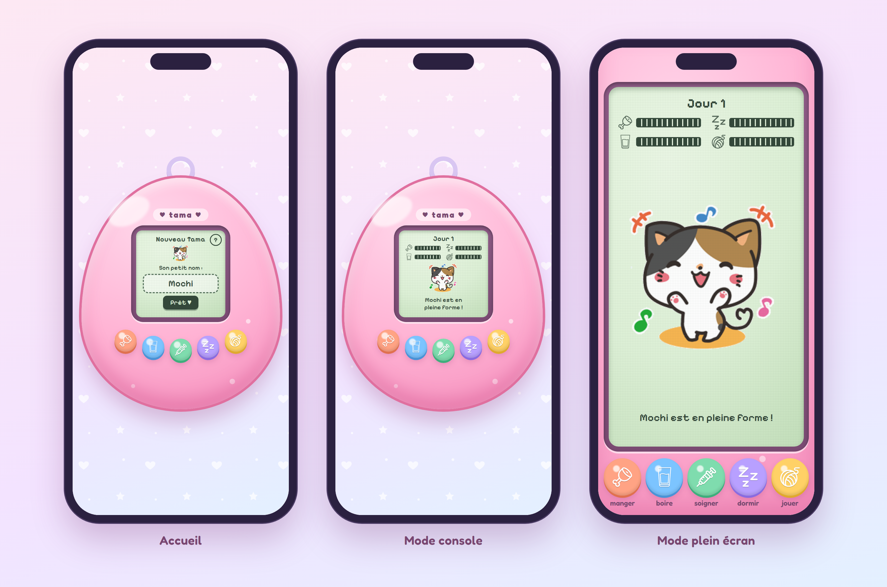
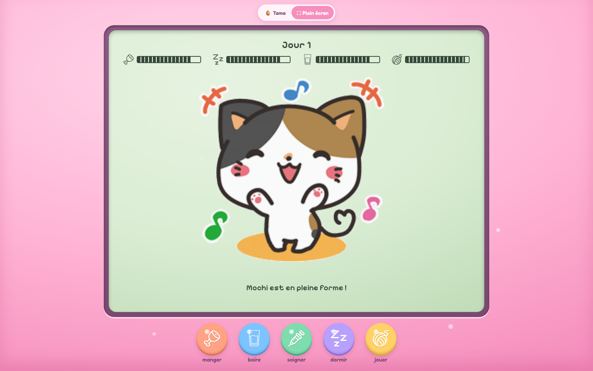

# Tamagotchi JS

Un mini-jeu en JavaScript inspiré des Tamagotchi. Le but est de prendre soin d’un animal virtuel en répondant à ses besoins.

**[Jouer en ligne](https://nihirii.github.io/tamagotchi_js/)**

## Comment jouer

- Nourris ton Tamagotchi et donne-lui à boire.
- Fais-le dormir et joue avec lui.
- S’il tombe malade, soigne-le d’abord. Les autres actions sont bloquées jusqu’à sa guérison.

## Contexte

J’ai réalisé ce projet en trois heures dans le cadre d’un exercice. L’objectif était de recréer en JavaScript un [Tamagotchi que j’avais d’abord développé en Python](https://github.com/Nihirii/Tamagotchi_PY). J’ai choisi d’ajouter la maladie pour donner une priorité aux actions du joueur.

## Interface

Le jeu prend la forme d’une petite console en œuf, avec un écran LCD et une police pixel. Sur téléphone comme sur ordinateur, un sélecteur permet de jouer dans la console ou en plein écran.

