# ◉ Tama·sub — Tamagotchi JS

Un mini-jeu en JavaScript inspiré des Tamagotchi, au style ocean tech. Le but est de prendre soin d’un petit requin-baleine virtuel en répondant à ses besoins.

**[▶ Jouer en ligne](https://nihirii.github.io/tamagotchi_js/)**

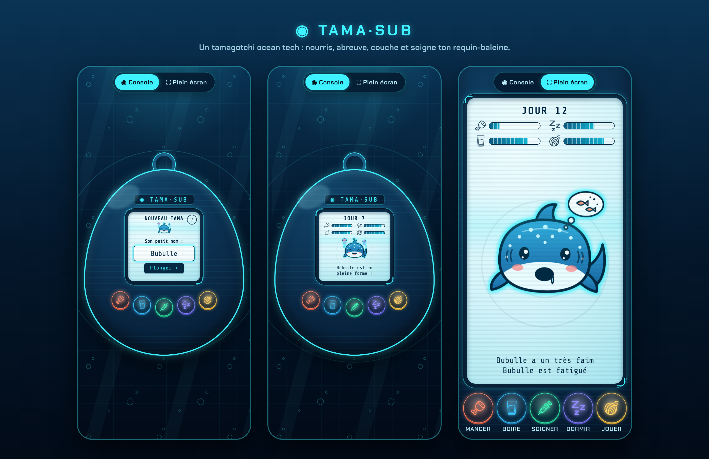

## Comment jouer

1. Donne un petit nom à ton requin-baleine, puis appuie sur **Plonger**.
2. Surveille ses quatre jauges : faim, énergie, soif et amusement.
3. Utilise les boutons pour t’en occuper :

| Bouton | Action |
|---|---|
| 🍗 Manger | Remplit la jauge de faim |
| 🥤 Boire | Remplit la jauge de soif |
| 💉 Soigner | Guérit ton requin-baleine quand il est malade |
| 💤 Dormir | Recharge son énergie |
| 🧶 Jouer | Remonte son amusement |

### Les règles

- Ne laisse jamais la **faim**, la **soif** ou l’**énergie** tomber à 0.
- S’il ne joue pas assez (amusement sous 50), il tombe **malade**.
- Malade, il faut d’abord le **soigner** : il ne peut plus manger, boire, jouer ni dormir.
- Un jour dure **5 secondes**.

## Émotions

Le requin-baleine change d’expression selon ses jauges.

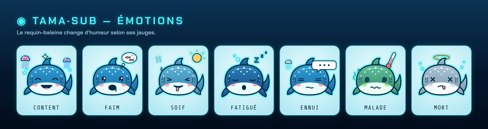

| | | | | | | |
|:-:|:-:|:-:|:-:|:-:|:-:|:-:|
| 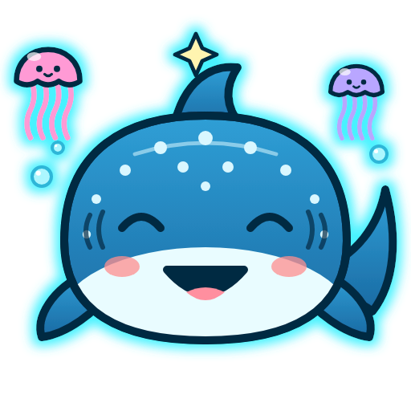 | 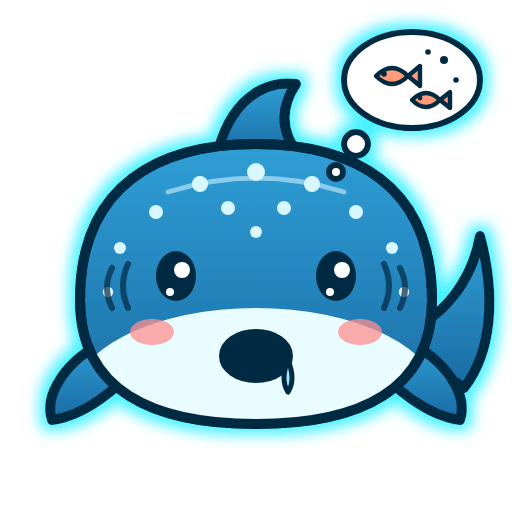 | 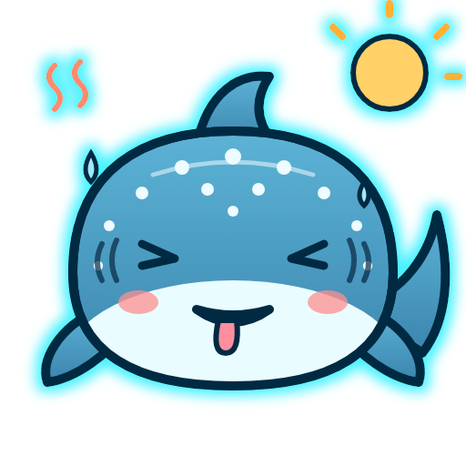 | 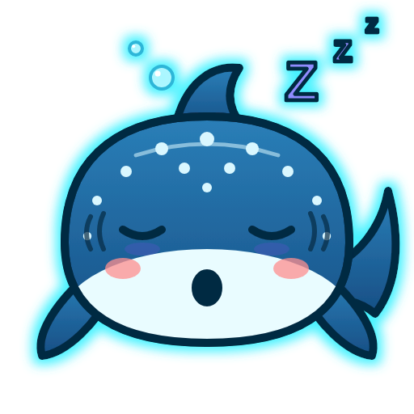 | 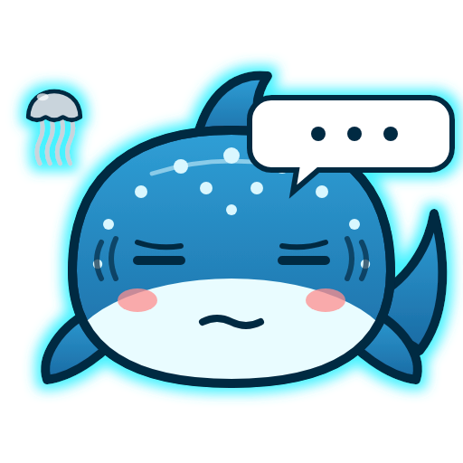 | 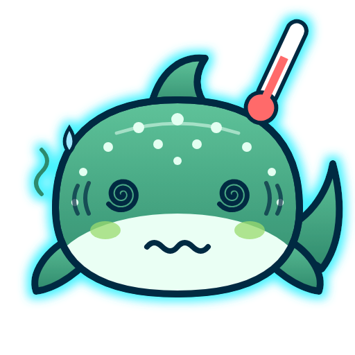 | 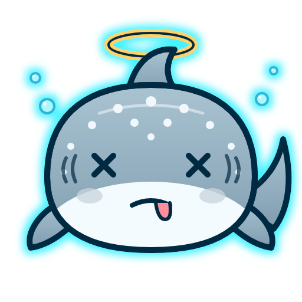 |
| Content | Faim | Soif | Fatigué | Ennui | Malade | Mort |

Les sources SVG des sprites sont dans [`resources/img/src/`](resources/img/src/).

## Interface

Le jeu prend la forme d’une console ocean tech : coque bleu abysse au contour néon cyan, écran façon sonar avec ligne de balayage, boutons lumineux et bulles en fond. Sur téléphone comme sur ordinateur, un sélecteur en haut de l’écran permet de jouer dans la **console** ou en **plein écran**.

### Sur téléphone

<p>
  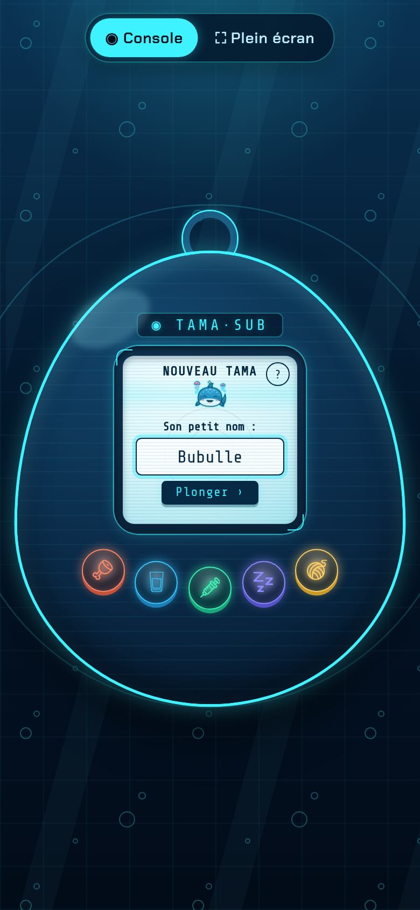
  
  
  
</p>

Accueil · Console · Plein écran · Fin de partie

### Sur ordinateur

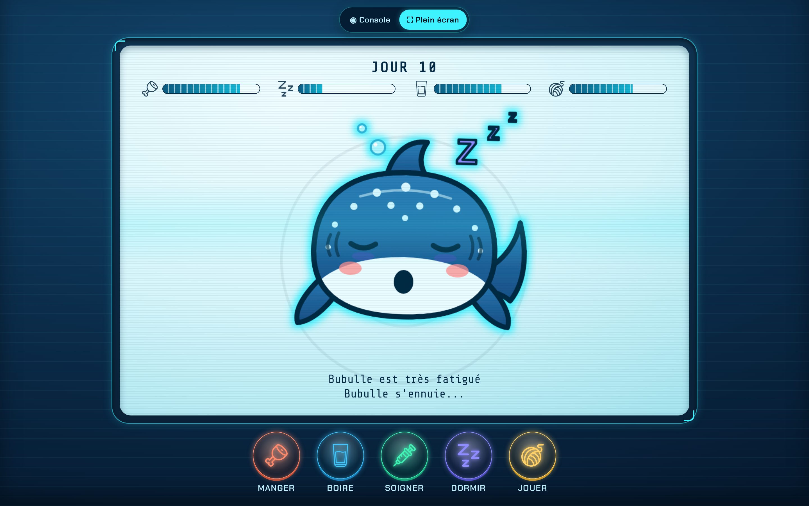

## Lancer le jeu en local

Le jeu n’a besoin d’aucune installation : clone le dépôt et ouvre `index.html` dans ton navigateur.

```bash
git clone https://github.com/Nihirii/tamagotchi_js.git
```

## Structure

```
index.html              Page du jeu
styles/theme.css        Design ocean tech
js/core/Tamagotchi.js   Logique du Tamagotchi (jauges, maladie, mort)
js/app.js               Affichage et boutons
resources/img/          Sprites du requin-baleine (PNG + sources SVG)
screenshots/            Captures d’écran du README
```

## Contexte

J’ai réalisé ce projet en trois heures dans le cadre d’un exercice. L’objectif était de recréer en JavaScript un [Tamagotchi que j’avais d’abord développé en Python](https://github.com/Nihirii/Tamagotchi_PY). J’ai choisi d’ajouter la maladie pour donner une priorité aux actions du joueur.
