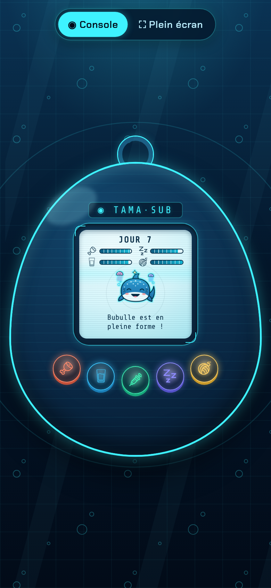
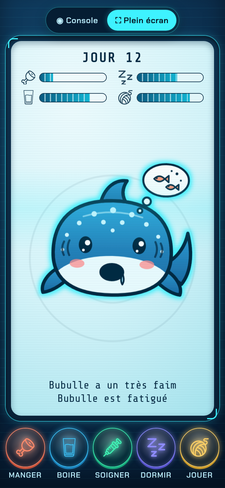

# Tamagotchi JS

Un mini-jeu en JavaScript inspiré des Tamagotchi. Le but est de prendre soin d’un petit requin-baleine virtuel en répondant à ses besoins.

**[Jouer en ligne](https://nihirii.github.io/tamagotchi_js/)**

## Comment jouer

- Nourris ton requin-baleine et donne-lui à boire.
- Fais-le dormir et joue avec lui.
- S’il tombe malade, soigne-le d’abord. Les autres actions sont bloquées jusqu’à sa guérison.

## Contexte

J’ai réalisé ce projet en trois heures dans le cadre d’un exercice. L’objectif était de recréer en JavaScript un [Tamagotchi que j’avais d’abord développé en Python](https://github.com/Nihirii/Tamagotchi_PY). J’ai choisi d’ajouter la maladie pour donner une priorité aux actions du joueur.

## Interface

Le jeu prend la forme d’une console ocean tech : coque bleu abysse au contour néon cyan, écran façon sonar avec ligne de balayage, boutons lumineux et bulles en fond. Sur téléphone comme sur ordinateur, un sélecteur permet de jouer dans la console ou en plein écran.

  
  
  

## Émotions

Le requin-baleine change d’expression selon ses jauges : content, faim, soif, fatigué, ennui, malade et mort. Les sources SVG des sprites sont dans `resources/img/src/`.

